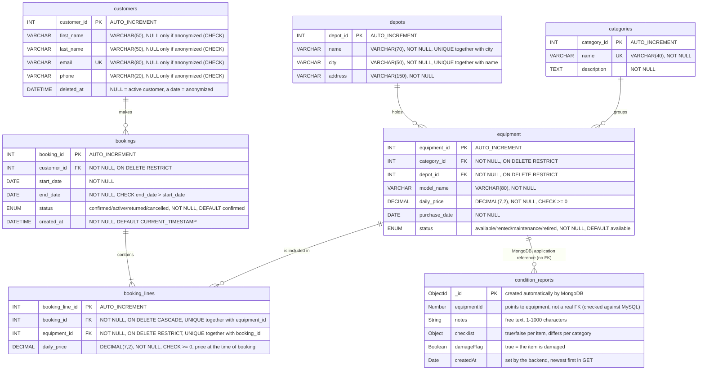

# NordicRent — ER Diagram

The MySQL tables match `database/setup.sql`. The MongoDB document `condition_reports` matches what `POST /api/reports` saves.



The total price is not stored as a column. It is calculated from `booking_lines.daily_price` × number of days (`end_date` − `start_date`).

## Named constraints

| Table | Constraint | Rule |
|---|---|---|
| `depots` | `uq_depot_location` | the same name cannot appear twice in the same city |
| `customers` | `chk_customer_personal_data` | an active customer (`deleted_at` is `NULL`) must have all four personal fields |
| `equipment` | `fk_equipment_category`, `fk_equipment_depot` | must point to an existing category and depot (RESTRICT) |
| `equipment` | `chk_equipment_daily_price` | `daily_price >= 0` |
| `bookings` | `fk_booking_customer` | must point to an existing customer (RESTRICT) |
| `bookings` | `chk_booking_duration` | `end_date > start_date`, so the shortest booking is one day |
| `booking_lines` | `fk_booking_lines_booking` | lines are deleted together with their booking (CASCADE) |
| `booking_lines` | `fk_booking_lines_equipment` | equipment used in a booking cannot be deleted (RESTRICT) |
| `booking_lines` | `uq_booking_equipment` | the same equipment cannot appear twice in one booking |
| `booking_lines` | `chk_booking_lines_daily_price` | `daily_price >= 0` |

## Connection between backend and frontend

The database stores relationships as IDs. A row in `equipment` only has `category_id` and `depot_id`, which are numbers, for example `category_id = 1` and `depot_id = 1`. A frontend that lists equipment wants to show the user "Kayak" and "Umeå", not 1 and 1.

The backend bridges the gap. In `GET /api/equipment` it joins `equipment` with `categories` and `depots`, so that the category name and the depot's city come from their own tables, and sends the result back as JSON that a frontend can show directly. One item from the response:

```json
{
  "equipment_id": 1,
  "model_name": "Prijon Kodiak",
  "city": "Umeå",
  "status": "available",
  "current_daily_price": "350.00",
  "category_name": "Kayak"
}
```

This is also why the normalized design works in practice: the category name and the depot's city are stored only once, in their own tables, and the JOIN puts them together when they are needed. If a category is renamed, only one row changes, and every response from the API shows the new name.

The short text about 3NF, relationships, the MongoDB choice and the transaction is in the [README](../README.md#database-design).

The diagram exported as an image: [`er-diagram-nordicrent.png`](er-diagram-nordicrent.png).
