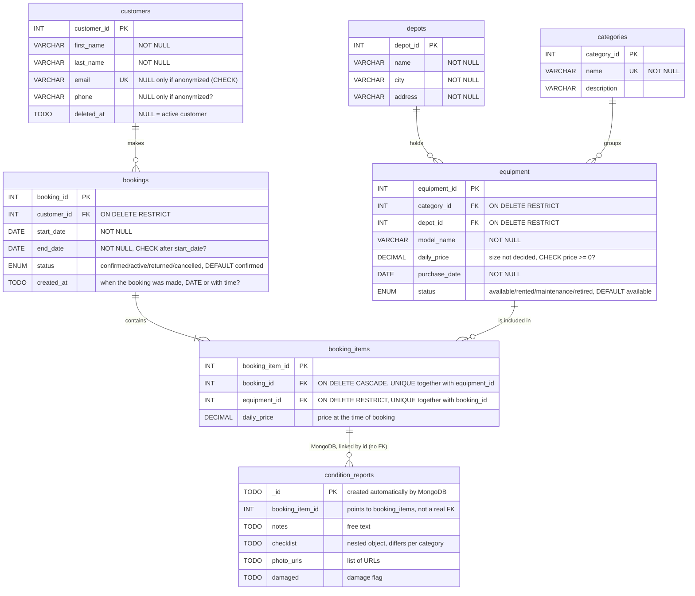

# NordicRent — ER Diagram

`TODO` = data type not decided yet (to be handled in step 2).

The total price is not stored as a column. It is calculated from `booking_items.daily_price` × number of days (`end_date` − `start_date`).

For the submission, the diagram must be exported as an image or PDF.
